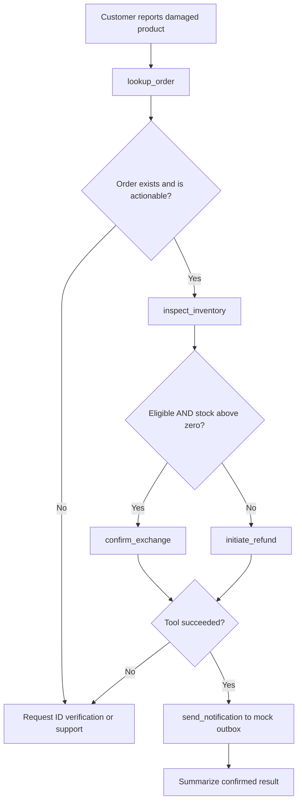

# Decision-Making Resolution Agent

**Xebia FDE Launchpad · Agentic AI — Build an Agent That Uses Tools**

A Python tool-using customer-service agent that autonomously investigates a damaged-product request and chooses an **exchange if the product is eligible and in stock**, or a **refund otherwise**. Each successful resolution also records a confirmation notification.

> **Demonstration safety:** This project uses a local SQLite database. Refunds and exchanges are locally recorded simulations, and confirmation emails go to a local mock outbox. **No real payments, shipments, or emails are sent.**

## What the project demonstrates

- **Real LLM tool calling:** Recommended `--mode gemini` uses a Google AI Studio API key; `--mode openai` also remains available. Both let an LLM choose its next tool from JSON-schema function tools.
- **Runs without an API key:** Default `--mode offline` uses a deterministic, *non-LLM* planner that emits the same structured tool calls for demonstration and automated tests.
- **Five isolated tools:** `lookup_order`, `inspect_inventory`, `confirm_exchange`, `initiate_refund`, `send_notification`.
- **Safe dispatch:** Whitelisted tool registry, required argument/type validation, controlled error results, no arbitrary code execution.
- **Stateful ReAct-style loop:** Ordered assistant messages, tool call identifiers, JSON results fed back to the planner/model, and strict max-iteration escalation.
- **Business guardrails:** Atomic stock reservation, no refund when an eligible exchange exists, correct customer email, repeat-call idempotency, and persisted results.
- **Tests:** Acceptance criteria plus failure and safety paths using Python's built-in `unittest`.

## Agent workflow



## Quick start (macOS / Linux / Windows)

**Prerequisite:** Python 3.10 or later. Default offline demo requires no third-party packages.

From the repository root:

```bash
# Interactive free-text demo (customer enters a message)
python3 main.py --interactive --reset-db

# Scenario A: damaged headphones, zero stock -> refund
python3 main.py --order ORD-1001 --reset-db --show-state

# Scenario B: eligible speaker with stock -> exchange
python3 main.py --order ORD-1002 --reset-db --show-state

# Scenario C: ineligible sleeve -> refund despite inventory
python3 main.py --order ORD-1003 --reset-db

# Scenario D: nonexistent order -> helpful verification message
python3 main.py --order ORD-9999 --reset-db

# Run the full automated test suite
python3 -m unittest discover -s tests -v
```

Use `--reset-db` **only when you want to restore demo orders and stock to their original values**. Without it, SQLite preserves previous transactions in `runtime/orders.db`.

### Real Gemini agent (recommended for the Xebia assignment)

1. Create a **Gemini API key** in [Google AI Studio](https://aistudio.google.com/api-keys). The Gemini API offers a limited free tier for eligible models/projects; check your project's quotas and model access. **Do not share or commit the secret key.**
2. In VS Code's terminal, from this folder, run:

```bash
python3 -m venv .venv
source .venv/bin/activate
python3 -m pip install -r requirements.txt
```

3. Configure the secret key in the **same terminal** (macOS / zsh):

```bash
read -rs "GEMINI_API_KEY?Paste your Gemini API key: "
echo
export GEMINI_API_KEY
python3 -c 'import os; print("Gemini key configured:", bool(os.getenv("GEMINI_API_KEY")))'
```

The key is not echoed on screen. You should see `Gemini key configured: True`.

4. Launch the real, tool-calling agent:

```bash
python3 main.py --interactive --mode gemini --reset-db
```

At `Customer>`, type `My order ORD-1001 arrived damaged. I want a replacement.` and press Enter. The model should use the order and inventory tools, initiate a **mock** refund, and record a **mock** notification. Repeat with `ORD-1002` for the exchange path; type `exit` to leave.

The default Gemini model is `gemini-3.8-flash`. Google restricts the older `gemini-2.5-flash` model for new projects. If your project cannot access Gemini 3.8 Flash, try an available function-calling model such as `--model gemini-3.5-flash-lite`, subject to your account’s available models and quotas. Gemini is reached using Google's [OpenAI-compatible endpoint](https://ai.google.dev/gemini-api/docs/openai), so the `openai` Python package in `requirements.txt` is **intentional**; you do **not** need an OpenAI API key or OpenAI credits for `--mode gemini`.

**Live LLM caveat:** The automated tests cover Gemini configuration, provider-compatible tool schemas, and tool-call message handling with mocked API responses; an actual Gemini network call must be verified using your own valid key and available quota before submission.


**Slow-request troubleshooting:** Gemini 3.8 may take multiple model turns for a complete resolution. The terminal now shows a progress line before each model call and after each tool call, rather than remaining blank until the end. To avoid indefinite waits, Gemini requests use a 45-second timeout *per model request*, with automatic SDK retries disabled during the demo. A full multi-tool workflow can still take longer than 45 seconds overall. If it reports `APITimeoutError`, test the network/model with the independent diagnostic below; do not repeatedly submit the same order while a request is running.

**Standalone API diagnostic** (one minimal model request; requires Gemini key):

```bash
python3 scripts/check_gemini_connection.py
```

If this diagnostic also times out, the delay is not in the order-resolution tool logic. Check network connectivity, Google AI Studio quotas, and try another network or available model. The script does not show your key.

**Gemini HTTP 400 troubleshooting:** Some Gemini OpenAI-compatible API versions reject the `additionalProperties` JSON Schema keyword within tool definitions. This project now automatically removes that field **only from schemas sent to Gemini**; the local dispatcher still rejects unexpected arguments. If an API request fails, the terminal also prints the provider's short error reason under `API ERROR DETAILS (no credentials)`, where available. Errors can still arise from a model unavailable to your project, geographic restrictions, or unsupported parameters; inspect the specific API message rather than changing keys blindly. Never paste a key or terminal command containing a key into a chat or GitHub issue.

### Optional OpenAI agent

If you have OpenAI API credits, set `OPENAI_API_KEY` securely and run:

```bash
python3 main.py --interactive --mode openai --reset-db
```

Both real LLM modes require network access and available provider quota. `--mode offline` does not use an LLM.


## Interactive customer-input demo (recommended for evaluator)

From the repository root, run:

```bash
python3 main.py --interactive --reset-db
```

Then type a request in the terminal:

```text
Customer> My order ORD-1001 arrived damaged. I need a replacement.
Customer> My order ORD-1002 arrived broken. Please help.
Customer> My order ORD-9999 has an issue.
Customer> exit
```

For each request, the agent prints its **tool execution trace** and a **customer response**.
It remembers completed refunds/exchanges in the local SQLite database across inputs, so repeating an order does not duplicate transactions.
The default offline planner recognizes order IDs in natural-language messages; it does not interpret arbitrary issue details with an LLM. For real model interpretation and tool selection, use `--interactive --mode gemini` with `GEMINI_API_KEY`, or `--mode openai` with `OPENAI_API_KEY`.

Only the seeded order IDs are present by default; an unknown order asks the customer to check the ID. `--reset-db` wipes prior demo results and restores the original stock. All refunds and notifications are simulated.

## Seeded customer cases

| Order ID | Product | Exchange eligible | Starting stock | Expected result |
| --- | --- | --- | ---: | --- |
| `ORD-1001` | Wireless Headphones | Yes | 0 | Refund ₹3,499.00 |
| `ORD-1002` | Bluetooth Speaker | Yes | 4 | Confirm exchange; stock becomes 3 |
| `ORD-1003` | Laptop Sleeve | No | 2 | Refund ₹899.00 |
| `ORD-9999` | Not found | — | — | Ask customer to verify order ID |

## Repository structure

```text
.
├── main.py                         # CLI and trace output
├── resolution_agent/
│   ├── agent.py                     # Model interface + bounded tool loop
│   ├── contracts.py                 # Tool schemas, registry, validation
│   ├── db.py                        # SQLite tables and demo seed data
│   └── tools.py                     # Five safe, deterministic tool actions
├── tests/
│   ├── test_agent.py                # End-to-end acceptance tests
│   ├── test_gemini_provider.py      # Gemini adapter tests (mock API, no network)
│   ├── test_interactive.py          # Typed terminal input tests
│   └── test_guardrails.py           # Validation and safety tests
├── requirements.txt                # SDK for real Gemini / OpenAI LLM modes
├── .env.example                     # Example configuration only
└── .gitignore                       # Excludes secrets/runtime database
```

## How the ReAct / tool loop works

1. Initialize the conversation with a system policy and the customer's request.
2. Send the full conversation and tool schemas to a provider (Gemini, OpenAI, or offline planner).
3. Check for tool calls; if present, verify the name is in an explicit registry and validate every JSON argument.
4. Execute the deterministic Python tool. Append the structured result to conversation history with its original `tool_call_id`.
5. Repeat until a final customer-facing answer arrives. A strict default ceiling of **5 model cycles** prevents unlimited execution; hitting it triggers human escalation.

The tool layer **independently enforces** exchange/refund policies even if an LLM requests an incorrect operation. Refunds, exchanges, and notifications are recorded only once per order. Monetary values are stored as integer paise to avoid floating-point errors.

## Acceptance criteria

| Assignment requirement | Implementation / proof |
| --- | --- |
| Autonomous investigation | `lookup_order` then `inspect_inventory` from structured tool calls |
| Stock = 0 → refund | `ORD-1001` scenario and test |
| Stock > 0 → exchange | `ORD-1002` scenario; inventory decremented atomically |
| Ineligible for exchange → refund | `ORD-1003` scenario and test |
| Confirmation + clear summary | `send_notification` mock outbox and final agent response |
| Invalid order identifier | `ORD-9999` scenario returns verification request |
| Safe tool registration | `Dispatcher.registry` in `contracts.py` |
| Parse errors and bounded execution | `MALFORMED_JSON` result and iteration-limit tests |

## Production considerations

This is a **local assignment prototype**, not a production financial service. For production, replace the SQLite seed data with authorized order/inventory APIs, connect a real payment provider and transactional email delivery, require identity verification and explicit financial permissions, implement auditing, monitoring, rate limits and human review, and verify provider callbacks before claiming payment/email success.

## Testing and GitHub publishing

```bash
python3 -m unittest discover -s tests -v
```

All tests are local, require no key, and do not make external API calls. Then try the **real Gemini mode** above using your own key.

To create a public repo, first confirm Git will not include a secret or local database:

```bash
git status --short
# .env and runtime/ are ignored by .gitignore
```

Never put any provider secret in `main.py`, `README.md`, `.env.example`, terminal screenshots, or commits. If a key was exposed in chat or on GitHub, revoke it and create a new one.

## Author / submission

Created for the **Xebia FDE Launchpad Agentic AI assignment**. Submit the GitHub repository URL after pushing the project.
